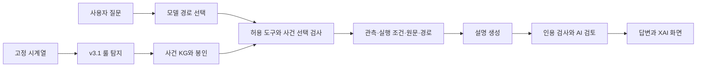

# 처음 담당하는 사람을 위한 Agent → End-to-End(XAI) 안내

이 작업은 사용자의 질문을 실제 과거 사건과 연결하고, 어떤 관측이 어떤 규칙에 걸렸는지 원문과 함께 설명하는 흐름을 완성하는 일이다. 출발점은 2026-11-13 main 커밋 `020c863`이다. 개발 브랜치는 `codex/agent-e2e-xai-20261113`이다.

현재 화면은 네 사람의 실험을 반영한 선택형 통합 앱으로 확장했다. [최신 통합 앱 안내](TEAM_AGENT_APP_20261113.md)의 선택 방식·적용 범위를 먼저 확인한다. 아래 내용은 기본 사건 설명 흐름을 익히기 위한 설명이다.

## 1. 먼저 역할을 이해하기

| 이름 | 이 프로젝트에서 하는 일 |
|---|---|
| 탐지기 | 시계열 값과 실행 규칙을 비교해 알람과 사건 후보를 만든다. |
| 사건 KG | 사건과 센서·일치 규칙·출처를 연결해 저장한다. |
| 도구 | 목록 찾기, 특정 사건 근거 찾기, 상관 후보 찾기를 코드로 실행한다. |
| Agent | 질문을 보고 도구와 인자를 고른다. 코드는 선택을 검사하고 실행한다. |
| 설명 생성 | 도구가 반환한 관측·규칙·원문으로 한국어 답변을 만든다. |
| XAI | 관측값, 실행 조건, 원문 조건, 실제 조회 경로와 판단 한계를 사용자가 추적할 수 있게 보여준다. |
| End-to-End | 이 구성 요소를 하나의 실행 흐름에서 연결하고 기록을 남긴다. |

이번 Agent는 모델의 JSON 선택을 코드가 검사·실행하는 제한된 도구 라우팅 방식이다. 자유로운 코드 작성·임의 Cypher 실행은 제공하지 않는다. 문서 질문은 기존 Agent v4.1의 검색·검토 흐름으로 전달한다.



## 2. 준비 단계에서 확인할 것

PowerShell에서 작업 폴더로 이동한다.

```powershell
cd 'C:\Users\User\OneDrive\문서\ChatGPT\26-2 비타민 학기 프젝\agent-e2e'
$env:PYTHONUTF8='1'
..\.venv\Scripts\python.exe scripts/run_xai_agent.py --prepare
```

이 명령은 고정 시계열과 KG에서 v3.1 사건을 만들고, SHACL·적재 검사를 거쳐 오버레이를 만든다. 이미 준비된 폴더가 있으면 봉인 무결성을 확인한다. 기존 완료 폴더를 덮어쓰지 않는다. 새 모델 호출은 없다.

이번 준비 결과는 알람 120개, 사건 17개, 상관 후보 2개다. 이것은 실행 산출물의 개수이며 정확도 점수가 아니다. 공개 라벨은 이 준비 과정에서 읽지 않는다.

## 3. 무료로 사건 목록 확인하기

```powershell
..\.venv\Scripts\python.exe scripts/run_xai_agent.py --inspect
```

목록의 `id`는 설명할 사건을 선택할 때 사용하는 값이다. 센서·시각이 같은지 확인하고 ID를 질문에 넣으면 된다. 여러 사건이 검색되면 Agent가 목록을 돌려주고 한 사건을 선택하도록 요청한다. 모델이 임의로 만들어낸 ID는 도구가 거부한다.

## 4. 화면에서 저장된 결과부터 보기

```powershell
..\.venv\Scripts\python.exe scripts/run_xai_agent.py --serve --port 8770
```

브라우저에서 `http://127.0.0.1:8770/`을 연다. 키는 기존 `OPENAI_API_KEY` 환경변수 또는 이 작업 폴더의 로컬 `.env`에서 읽으며 화면에 표시하지 않는다.

1. 화면을 열면 선택한 탐지 방식의 최신 통합 앱 실행을 표시한다. 맨 아래 **저장된 실행**에서도 같은 방식의 결과를 선택할 수 있다. 예전 단일 앱의 `xai_real_20261113_02`는 원본 폴더에 보존하지만 새 통합 앱 기록 목록과 구분한다.
2. **기록 열기 · 무료**를 누른다. 이 동작은 API를 호출하지 않는다.
3. 답변 상태, 관측값, 실행 규칙, 원문, 실제 조회 경로, 검토 결과를 차례로 읽는다. 첫 실행은 기록 폴더에 보존하고 화면 목록에서 숨겼다. 표시 설정은 `kg_build/xai_display.json`에 있다.

기본 화면의 사건 목록 조회도 무료다. **Agent 질문 실행**은 API를 사용한다. 기본 사건 설명은 계획·초안·검토의 최대 3회 모델 호출을 사용하며 문서 임베딩을 새로 만들지 않는다. 문서 질문은 별도 기존 v4.1 경로의 제한을 따른다.

## 5. 직접 질문하기

- 목록을 보고 싶으면 `과거 사건 목록을 보여줘.`라고 입력한다.
- 한 사건을 설명하려면 상단 사건을 선택하고 **선택 사건으로 질문 채우기**를 누른다.
- `현재 센서 측정값을 조회해줘.` 같은 요청은 연결 범위 부족으로 안내한다.
- `MAINT-05의 조건과 조치는?` 같은 문서 질문은 기존 문서 Agent로 보낸다.

질문에 관측값·출처·정답 문장을 넣을 필요가 없다. 사건 ID 또는 조회 조건을 입력하면 실제 값과 근거는 도구에서 가져온다. 모델이 필터를 잘못 선택할 수 있으므로 `plan.json`과 도구 기록도 확인한다.

## 6. XAI 화면을 읽는 순서

1. **관측**에서 실제 기록의 센서·시각·값을 확인한다.
2. **실행 조건과 구현 설정**에서 문서가 정한 값과 팀이 정한 기본값을 구분한다. `duration_seconds=0`이 엔진 기본값이면 문서에 0초가 적혀 있다고 설명하지 않는다.
3. **원문**에서 인용된 규칙의 수치·부등호·기간·조치를 확인한다.
4. **그래프 경로**에서 사건의 센서·일치 규칙·문서·provenance 연결을 확인한다. 실제 저장된 간선만 표시한다.
5. **답변 검토**에서 승인 또는 보류 사유를 확인한다. AI 검토 통과는 현장 안전 인증이 아니다.

종료 시각과 구간 통계는 사후 정보다. 화면의 유형은 탐지기 추정 분류이며, 상관 후보는 규칙 패턴 일치다. 실제 원인이나 조치 수행 이력은 별도의 관측·실행 자료가 있어야 확인할 수 있다.

## 7. 실행 기록 위치

한 질문의 기록은 `kg_build/graphrag_live/<실행ID>/`에 저장한다.

| 파일 | 검토할 내용 |
|---|---|
| input.json, plan.json | 사용자 질문과 모델의 경로 선택 |
| tools/trace.json, tool_*.json | 실제 도구·인자·반환 결과·오류 |
| retrieval.json | 모델에게 전달한 전체 근거와 출처 ID |
| draft.json | 생성한 초안 |
| verification.json | 인용 검사와 AI 검토 결과 |
| answer.json | 최종 상태·답변·근거·XAI 자료 |
| agent_lock.json, store_lock.json | 모델 설정·코드·지침·탐지/KG 봉인 기록 |

도구 실패, 잘못된 모델 응답, 인용 불일치와 검토 거절은 기록하고 종료한다. 완료된 실행을 덮어쓰거나 성공할 때까지 자동 반복하지 않는다.

## 8. 이번에 확인한 범위와 다음 연습

준비한 입력에서 탐지 → 사건 KG → 사건 도구 → 실제 모델 경로 선택·설명·검토 → 화면의 기본 흐름을 확인한다. 대표 실제 모델 실행과 모의 회귀 검사는 별도 결과로 기록한다. 이전의 사건 17건 검색·답변 연계 재평가를 이 작업에 넣지 않는다.

다음 연습은 저장된 성공 사례를 열어 관측·실행 조건·원문을 따라 읽은 뒤, 목록 요청과 다중 사건 선택을 직접 확인하는 것이다. 실제 모델 전체 품질 평가는 새 문항과 고정 채점 기준을 별도로 준비해 진행한다. 이 대표 사례의 정상 실행을 전체 정확도 점수로 보고하지 않는다.
