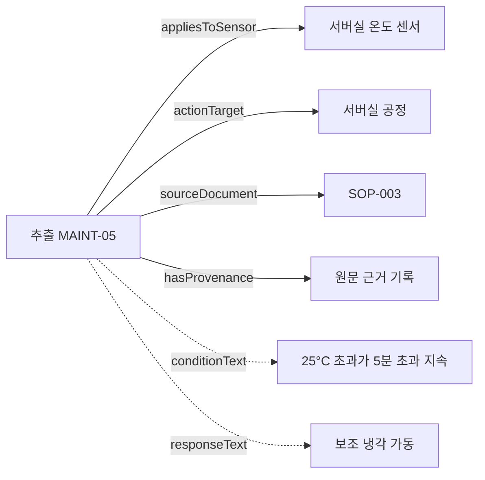

# 예원 v2 고정 — 온톨로지·KG 기여와 GraphRAG 활용 검토

2026-10-27. 사용자가 선택한 **원래 예원 v2 KG만** 기준으로 ① 원본 대비 변화, ② 대표 질문과 관계 경로, ③ 남은 한계의 유형을 순서대로 정리했다. KG 교체·관계 병합·추출 재실행·모델 비교는 하지 않았다.

## 검토 대상 고정

- 실제 GraphRAG 로더: `src/imaks_kg/rag/comparison.py`의 `KG_REL`.
- 대상: `artifacts/stage6_final_20261016/inputs/kg_build/openai_sol_v2_20261016/graph/candidate.ttl`.
- SHA-256: `8ab82a866135afd1335caab06fe6e6e223d7b1ea37195e3fe6509cbbd407ef51`.
- 스키마: `ontology_v1/ontology.ttl`, 제약: `ontology_v1/shapes.ttl`.
- 과거 3,016트리플 관계 보완 KG, 관계 후보 6개, 다른 팀 결과는 현재 KG의 기여 집계에서 제외한다.
- 센서 탐지 후보 그래프는 별도 응용 산출물이다. v2에 합산하지 않는다.

이번 검토는 원본 seed CSV 해시 확인, 현재 로더로 KG 읽기, RDF 집계 및 대표 노드 조회, SHACL 재실행을 수행했다. 정답 라벨과 유료 API는 사용하지 않았다.

## 1단계. 원본 KG와 v2의 차이

### 구조 변화

| 원본 seed | v2의 처리 | 성과의 성격 |
|---|---|---|
| Component 9개 | Station 9개로 의미를 명확히 하여 변환 | 개념 매핑·표현 정리 |
| Sensor 22개 | Sensor 22개 유지, 소속·단위·유형 표현 | 기존 개체 보존 |
| monitors 44행 | Station → hasSensor → Sensor 22관계로 통합 | 방향 통일·중복 정리 |
| feeds_into 3행 | feedsInto 3관계 | 공정 순서 보존, 인과관계 아님 |
| Maintenance 8개 및 센서 연결 | MaintenanceRule로 보존, appliesToSensor로 연결 통일 | 기존 정비 지식의 스키마 매핑 |
| 문서 자료 | Document 7개, 문서 추출 Rule 100개 추가 | 문서 기반 KG 데이터 확장 |
| 원본 행·문서 위치 | Provenance 및 문서 연결 | 출처 추적 구조 |
| 원본 사건·인물 등 | 아래 범위 제한에 따라 제외 | 의도적인 범위 선택 |

원본은 노드 115개, 간선 CSV 341행이다. v2의 2,806은 **RDF 트리플 수**로 타입·문자열 속성·출처 메타데이터까지 포함한다. ‘341개 관계가 2,806개 관계로 증가했다’고 비교하지 않는다.

원본에는 System 1, Zone 7, Component 9, Sensor 22, AnomalyEvent 14, Maintenance 8, Person 44, SafetyEvent 10개가 있었다. v2는 원본 전체를 옮긴 그래프가 아니다. 사건 14개, Person 44개 등의 개체는 현재 v2에 적재하지 않았다. Maintenance 8개는 최초 구조 변환에서 제외했다가 정비 규칙으로 별도 변환하므로 최종 제외 개체로 세지 않는다.

### 실제 v2 개체 수

| 클래스 | 수 |
|---|---:|
| Station | 9 |
| Sensor | 22 |
| Document | 7 |
| OperationalRule | 33 |
| ThresholdRule | 27 |
| MaintenanceRule | 19 |
| AccessRule | 29 |
| Provenance | 210 |

규칙은 총 108노드다. 기존 정비 규칙 8개 + LLM 추출 100개이며, 추출 100개는 SOP 95개와 데이터시트 5개다. 기존 정비 규칙과 추출 표현이 별도 노드로 남아 있으므로 **독립적인 신규 규칙 108개를 발견했다는 뜻이 아니다.**

### 실제 사용된 관계 수

| 관계 | 개수 | 의미 |
|---|---:|---|
| hasSensor | 22 | 공정의 센서 소속 |
| feedsInto | 3 | 물리적 공정 순서 |
| appliesToSensor | 72 | 규칙이 적용되는 센서 |
| actionTarget | 94 | 규칙에 기술된 조치의 대상 공정 |
| sourceDocument | 108 | 규칙의 출처 문서 |
| hasProvenance | 147 | 규칙·설비 등의 세부 출처 기록 연결 |

이 여섯 관계 유형은 팀이 합의한 온톨로지 v1에 이미 정의돼 있다. v2 추출 모델이 새로운 관계 유형 여섯 개를 자동 발명한 것이 아니다. 팀 공동 스키마 설계와 예원 v2의 데이터 구축 기여를 구분한다.

108개 규칙 모두 sourceDocument와 hasProvenance를 갖는다. conditionText를 가진 규칙은 100개다. 기존 seed 정비 규칙 8개에는 같은 속성이 없으며, 해당 조건은 추출 변형 노드나 원문에서 확인해야 한다. Provenance 210개와 hasProvenance 147개는 다른 집계다. 모든 Provenance가 개체에서 직접 연결된다고 해석하지 않는다.

### 온톨로지의 실제 기여

1. 공정·센서·규칙·문서·출처를 구분하는 공통 표현을 제공한다.
2. 규칙의 적용 센서와 조치 대상을 분리한다.
3. 문서와 세부 출처를 통해 답변 근거를 추적할 수 있게 한다.
4. 센서 소속, 허용 유형, 출처 필수 항목 등의 구조적 제약을 검증한다.

재실행한 SHACL 결과는 `conforms=true`다. 이는 정의된 제약의 통과이지, 모든 조건·조치 문장의 의미 정확성이나 도메인 타당성을 보장하는 결과는 아니다.

## 2단계. 대표 질문과 실제 관계 경로

아래는 현재 v2를 직접 조회해 확인한 **질문에 필요한 표현 경로**다. 모든 경로를 새 질문으로 API 실행한 것은 아니며, 실제 생성·검색 성능 평가는 기존 평가 보고서와 구분한다.

| 대표 질문 | v2에서 확인한 경로·속성 | 답변 가능한 범위 |
|---|---|---|
| ST01 유량 센서는 어느 공정 소속인가? | ST01_FILLING → hasSensor → ST01_FILLING_FLW | 센서 소속 |
| ST01 유량 유지 범위는 무엇이며 출처는? | 추출 RULE-ST01-01 → appliesToSensor → ST01_FILLING_FLW; 규칙 → sourceDocument → SOP-001; 규칙 → hasProvenance | conditionText의 112–128 L/min 및 근거 조회 |
| 서버실 MAINT-05의 조건과 조치는? | 추출 MAINT-05 → appliesToSensor → SRV01_SERVERROOM_TMP; conditionText·responseText; sourceDocument → SOP-003 | >25°C, >5분과 보조 냉각 조치. 실제 실행 여부는 알 수 없음 |
| ST02 고온 규칙의 정지 대상은? | 추출 RULE-ST02-02 → actionTarget → ST02_SEALING / ST03_LABELLING / ST04_PACKAGING | >210°C 조건에서 문서에 지정된 정지 대상 |
| RULE-ST04-03이 참조하는 규칙은? | responseText가 `Verify RULE-ST02-04.` | 문자열 참조를 파싱해 검색 가능. 규칙 간 직접 RDF 간선은 아님 |
| 현재 PLC가 종료됐는가? | 실제 제어 상태·조치 이력 없음 | 현재 상태 판정 불가 |

예를 들어 서버실 규칙의 구조는 다음과 같다.



점선으로 표시한 조건과 조치는 **텍스트 속성**이다. 별도 Condition·Action 클래스의 개체로 구현된 것이 아니다. ‘조건과 조치를 구조화했다’고 설명할 때도 이 표현 수준을 밝혀야 한다.

### GraphRAG가 활용하는 방식

- 구조 관계는 대상 센서·공정·규칙을 찾는 탐색에 사용한다.
- 문서·출처 연결은 관련 원문을 가져오는 데 사용한다.
- 규칙 ID가 조치 텍스트에 있으면 검색 코드가 참조 연결을 추가로 해석한다. 이 연결을 v2의 저장 RDF 관계라고 부르지 않는다.
- 기존 B/C 검색 실험에서 필수 근거 회수가 34/35→35/35로 증가했다. 한 문항의 규칙 참조·출처 확장 효과이며, 온톨로지 구조만의 고유 효과나 새 인과관계 발견의 증거는 아니다.

별도 센서 후보 설명은 후보 → 실행 규칙 → 기존 v2 규칙·원문을 조회하는 응용이다. 후보 93개와 관련 트리플은 현재 v2의 개체·관계 수에 더하지 않는다.

## 3단계. 남은 한계의 유형과 v2 유지 정책

| 관찰 | 문제 유형 | v2를 유지하며 취할 처리 |
|---|---|---|
| 규칙 ID나 비교 문서를 못 찾음 | 검색 문제 | 이미 구현한 ID 인식·문서별 근거 확보 활용. 스키마 부족으로 단정하지 않음 |
| 규칙 간 참조가 responseText에만 있음 | 표현 범위 + 검색 문제 | 텍스트 참조 탐색임을 표시. 현재 정리 작업에서 새 관계를 추가하지 않음 |
| 조건·조치가 텍스트 중심 | 온톨로지 표현 수준의 제한 | 자연어 설명과 자동 실행 가능한 규칙을 구분. 기존 룰 탐지기는 별도 구현임을 명시 |
| 현재 PLC 상태·작업자 명령·설치 제품 모델을 알 수 없음 | 입력 데이터 부족 | 답변 유보. 온톨로지를 늘리는 것만으로 해결되지 않음 |
| seed 규칙과 추출 변형이 함께 있음 | 통합·개체 식별 정책 | 두 출처 표현을 보존하고 중복 독립 지식으로 세지 않음 |
| 근거가 있는 문장인데 유사도 평가에서 미매칭 | 평가 단위·표현 민감도 | 추출 F1과 실제 내용 검토를 구분. 점수만 보고 KG의 유효 지식을 삭제하지 않음 |
| GraphRAG 점수가 높음 | 평가 해석의 제한 | 기존 문항 개발 재시험·AI 단독 검토로 보고. 미노출 일반화 성능으로 확대하지 않음 |

온톨로지에는 causallyAffects, correlatesWith, triggers, hasCause, hasEffect가 선언돼 있지만 **현재 v2에는 해당 관계 인스턴스가 없다.** 선언 존재를 인과관계·이상 이벤트 구축 완료의 증거로 사용하지 않는다.

별도 탐지 후보의 어휘는 온톨로지 v1과 별개의 응용 표현이다. 이번 v2 SHACL 통과가 그 후보 그래프까지 검증했다는 뜻도 아니다.

## 프로젝트 성과의 권장 표현

“팀에서 합의한 제조 온톨로지에 따라 기존 KG와 문서 추출 규칙을 예원 v2 지식그래프로 통합했다. 규칙의 적용 센서·조치 대상·출처를 연결하고, 이를 활용하는 GraphRAG 질의응답 및 과거 센서 후보 설명 기능을 구현했다.”

현재 성과는 **온톨로지 기반 KG 구축 및 GraphRAG 활용**이다. GraphRAG가 온톨로지를 자동 수정했다거나 새로운 제조 인과 법칙을 발견했다고 주장하지 않는다. 기존 주제를 폐기할 필요는 없지만, 제목·발표에서 실제 처리 순서와 검증 범위를 분명히 한다.

## 재현과 변경 범위

기존 가상환경에서 저장소 루트를 기준으로 실행한다.

```powershell
$env:PYTHONPATH='src'
$env:PYTHONUTF8='1'
..\.venv\Scripts\python.exe scripts/audit_ontology_contribution.py
```

원본 seed 파일은 기존 해시 검증 리더로 읽으며, 압축 파일이 있으면 전체 압축을 해제하지 않는다. 결과는 `evaluation/ontology_contribution_20261027/audit.json`과 `shacl.txt`에 저장된다. 재실행은 해당 감사 결과만 갱신한다. 기존 가상환경에 RDFLib·pySHACL과 기존 프로젝트 의존성이 있어야 한다.

이번 작업은 감사 스크립트와 문서를 추가했으며, v2 KG·온톨로지 v1·검색 정책·평가 정답·기존 점수를 수정하지 않았다. 새로운 관계 적용, 모델 호출, 신규 모델 설치도 없다.
