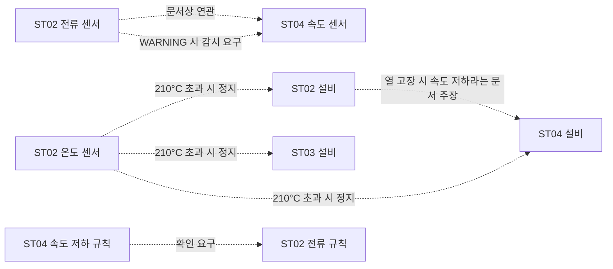

# 7차 이전 관계 발견 보완 — 구현 및 검증

## 범위와 결론

사용자가 요청한 범위는 7차 벤치마크 문항 작성 이전까지다. 벤치마크·Vector RAG·룰 탐지기·Agent는 실행하지 않았다.

고정된 GPT-6.1 Sol v2 규칙과 원문을 이용하여 **문서 명시 관계 검토 항목 7개, 검토용 관계 유형 5개** (기존 seed 관계 근거 보강 1개는 신규 제외, 구조화 확장 후보 6개)를 구성했다. 후보와 근거를 담은 RDF 91트리플을 기존 후보 KG에 합쳐 **2,897트리플**을 만들었다. 기존 v2 예측·팀 평가 F1 86.19%는 그대로 보존했다.

**검증된 새 인과관계는 0개, 사람 승인 관계도 0개다.** 이번 결과는 문서 지식의 구조화 확장이다. 문서에도 없는 새로운 물리적 관계를 발견했다고 주장하지 않는다. 승인 전 후보 그래프와 빈 승인 관계 그래프를 분리했다.

## 1. 기준 고정

- 기준 규칙: `kg_build/openai_sol_v2_20261016/llm_predictions.jsonl`.
- 예측 SHA-256: `ed6c1c3c4e1d10262fb9c25cf2a9639c6df3224d33ada3fd4e9a9d2d07e240b4`.
- 구조 비교: 기존 seed 변환 `structure.ttl` 및 v2 `candidate.ttl`.
- 입력: 전처리 문서 단위와 원본 CSV/PDF 해시. ground_truth 86건, 이벤트 정답, 새로운 센서 라벨을 입력으로 읽지 않았다. 단, 앞선 개발 과정의 정답 노출 이력을 소급 제거한 것은 아니다.
- 관계 후보는 기존 LLM 출력과 원문을 읽고 작성한 **AI 보조 해석 목록**이다. 새로운 독립 API 관계 추출 실험으로 표현하지 않는다. 추가 API 호출·패키지 설치는 없다.

## 2. 후보와 기존 KG 대조

| 후보 | 출발 → 도착 | 관계 의미 | 근거 | 판정 |
|---|---|---|---|---|
| REL-01 | ST02 전류 → ST04 속도 | 문서에 기술된 연관 | SOP-001 운영 규칙 + SOP-003 상관 고장 표 | 원본 seed correlates_with에 이미 있음; 신규 제외 |
| REL-02 | ST02 전류 → ST04 속도 | 전류 WARNING일 때 속도 감시 요구 | SOP-001 운영 규칙 | 조건부 감시 관계 |
| REL-03 | ST04 속도 저하 규칙 → ST02 전류 규칙 | 선행 규칙 확인 요구 | SOP-001 운영 규칙 | 규칙 간 명시적 참조 |
| REL-04 | ST02 온도 → ST02 설비 | >210°C일 때 비상정지 요구 | SOP-001 운영 규칙 | 조건부 조치 관계 |
| REL-05 | ST02 온도 → ST03 설비 | >210°C일 때 비상정지 요구 | 같은 원문 규칙 | 다중 대상 조치의 관계 표현 |
| REL-06 | ST02 온도 → ST04 설비 | >210°C일 때 비상정지 요구 | 같은 원문 규칙 | 다중 대상 조치의 관계 표현 |
| REL-07 | ST02 설비 → ST04 설비 | 열 고장 시 속도 저하 효과라는 문서 주장 | SOP-001 의존성 표 | 실측 인과관계로 확정하지 않음 |

원본 CSV의 correlates_with 1개도 직접 대조했다. 변환 KG에 생략돼 있어도 REL-01은 기존 관계로 분류한다. 기존 공정 흐름 feedsInto 3개도 신규로 세지 않는다. 기존 v2에는 적용 센서·조치 대상과 규칙 텍스트가 있으므로 대부분 후보의 정보는 이미 간접적으로 표현돼 있다. 새 이름의 관계를 만든 것만으로 새 사실을 발견한 것은 아니다. 이번의 새로움은 **조건·방향·관계 의미를 명시적인 검토 객체로 구조화한 것**이다. REL-07은 규칙 출력 외 원문 표에서 보완했다.

157개 전처리 원문 단위를 목록화했고, 후보 근거로 5개 단위를 사용했다. 목록화는 전 문서의 모든 관계를 빠짐없이 추출했다는 증거가 아니다. 관계 정답셋이 없으므로 관계 발견 precision/recall은 산출하지 않았다.

## 3. 그래프 표현

아래 화살표는 조건이 붙은 **후보 주장**이며 승인된 직접 인과 엣지가 아니다. 실제 RDF는 각 주장을 RelationCandidate 노드로 재구성하여 조건과 근거를 함께 보존한다.



## 4. 온톨로지 보완

기존 `ontology_v1/`은 변경하지 않았다. `ontology_relation_review/`에 검토용 확장 v0.1을 추가했다.

- `RelationCandidate`: subject, object, relationType, conditionText, reviewStatus, evidenceMode, novelty, evidence, supportedByRule.
- 관계 유형 5개: documentedAssociation, requiresMonitoring, requiresRuleCheck, requiresShutdown, documentedThermalEffect.
- 유형은 후보 주장에 사용되는 vocabulary다. 운영용 직접 ObjectProperty 또는 기존 causallyAffects의 대체로 자동 승인하지 않았다.
- SHACL은 대상 타입, 필수 조건, 허용 관계 유형, pending 상태, 원문 근거·페이지·해시를 검사한다.
- 실제 센서/설비가 없는 SCADA latency, QC HOLD를 새 Station으로 만들어 기존 domain/range를 우회하지 않았다.
- 원문 위치·표 좌표·파일 해시는 후보 JSON의 evidence에 보존하고, RDF 근거 노드에는 단위 ID·원문·페이지·파일 해시를 기록했다. 추가한 91트리플 모두 근거 소유 후보를 sidecar에 기록했다.

## 5. 보류·제외 판단

| 항목 | 이유 / 처리 |
|---|---|
| 기존 생산 흐름 3개 | seed에 이미 있음; 신규 제외 |
| 서버 과열 → SCADA 지연·겉보기 STUCK | 기존 규칙 텍스트 보존. 대상이 Station이 아니므로 이번 관계 확장에서 보류 |
| 창고 온도 → QC HOLD | 품질·ERP 대상은 현 온톨로지 범위 밖; 기존 규칙 텍스트 보존 |
| 여러 구역의 HVAC 의존성 | HVAC가 실제 같은 장치인지 식별되지 않음. 공통 원인 관계를 추정해 추가하지 않음 |
| RND 습도–창고 온도 시계열 관찰 | 이전 사후 탐색에서 단일 급변 영향이 컸고 독립 검증 미통과. 새 인과관계로 반영하지 않음 |

추가 데이터를 받지 않은 상태에서 같은 시계열을 반복 탐색하여 통과 결과를 찾지 않았다. 문서에도 없는 새 관계를 확정하려면 미사용 관측 구간·추가 실험 등 별도 근거가 필요하다.

## 6. 검증과 검토 상태

- 관계 확장 SHACL 통과. 기존 온톨로지 SHACL도 별도 검증하여 통과했다.
- 유효 그래프, 조건 누락 거부, 잘못된 대상 타입 거부, 임의 승인 거부, 후보의 인과 엣지 승격 거부, 승인 관계 그래프 비어 있음의 검사와 원본 seed 연관관계의 신규 제외 검사를 포함한 7개 테스트 통과.
- 인용·개체 참조·근거 연결은 프로그램 검증이다. 문장의 의미와 관계 방향 판단은 AI 보조 검토이므로 독립 사람 검증으로 세지 않는다.
- `human_review.json`에 7개 후보의 두 검토자 이름·판정 필드를 비워 두고 후보 그래프 해시를 기록했다. 사람이 승인하지 않은 관계를 확정 상태로 만들지 않았다.
- 기존 규칙 점수 86.19%는 관계 발견 정확도가 아니다.

## 7. 파일과 실행

- 생성 코드: `src/imaks_kg/kg/relation_candidates.py`.
- 테스트: `tests/test_relation_candidates.py`.
- 확장 스키마: `ontology_relation_review/ontology.ttl`, `shapes.ttl`.
- 출력 폴더: `kg_build/pre_benchmark_relations_20261016/`.
- 핵심 출력: `protocol_lock.json`, `candidates.json`, `deferred_and_existing.json`, `source_inventory.json`, `triple_evidence.json`, `relation_candidates.ttl`, `candidate_kg.ttl`, `approved_relations.ttl`, `human_review.json`, `summary.json`.

```powershell
$env:PYTHONPATH='src'
python -m imaks_kg.kg.relation_candidates
python -m unittest discover -s tests -p test_relation_candidates.py
```

## 8. 7차 전 인계 상태

자동으로 수행 가능한 후보 구성·기존 KG 대조·근거 정리·검토용 온톨로지/SHACL·후보 KG·검토 양식을 준비했다. **팀의 관계 유형 승인과 두 단계 사람 검토는 아직 남아 있다.** 이 승인을 수행한 것으로 대체하지 않는다. 현 시점에는 7차를 시작하지 않았고 새 벤치마크 문항도 만들지 않았다.
