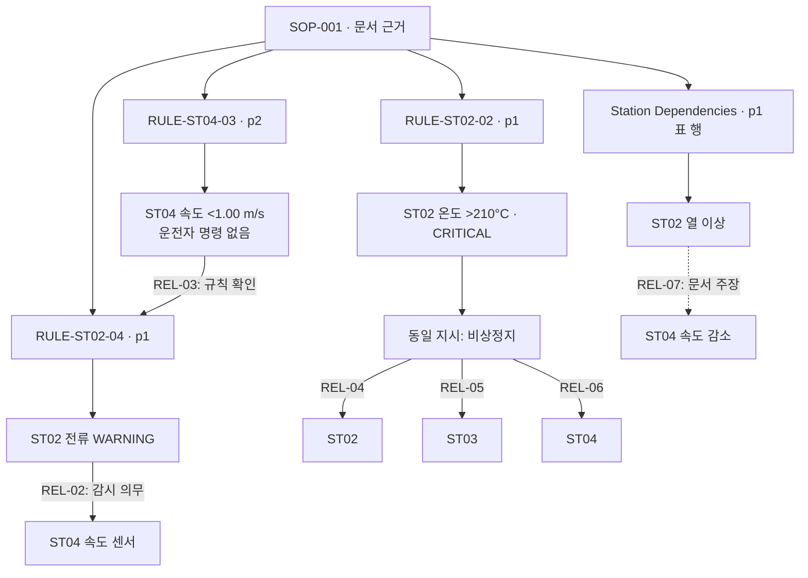

# 6차 최종본: v2 추출 평가 및 문서 기반 KG 보완

작성일: 2026-10-16. 최종본 경로: `kg_build/stage6_final_20261016/`.

팀 공유용 파일은 [공유 묶음과 재실행 안내](../artifacts/stage6_final_20261016/README.md)에 있다. 최종 KG뿐 아니라 최소 입력 스냅샷을 포함해 원본 PDF·API·로컬 모델 없이 재구성할 수 있다. 공유 파일 해시, 기본·확장 SHACL, 재생성 그래프 동등성도 별도로 검사한다.

## 완료 범위

기존 v2 추출 결과와 seed KG에 조건·조치·근거를 보완한 문서 기반 KG를 생성했다. 관계 후보 6개에 AI 검토 결과를 연결하고, 비상정지 대상 3개를 하나의 지시로 묶었다. 기존 seed에 있던 연관 관계 1개는 신규에서 제외했다. 7차 벤치마크는 작성하지 않았다.

여기서 최종본은 **6차의 문서 기반 KG 구현 산출물**을 의미한다. 도메인 전문가 승인, 독립된 평가, 현장 안전성 검증 또는 새 인과관계 발견을 완료했다는 의미가 아니다. 사람 검토 상태는 pending이며, 사람 승인 관계와 경험적으로 검증된 신규 인과관계는 모두 0개다.

## 구현 과정

1. 동결된 v2 추출 예측, 기존 후보 KG, AI 검토 기록의 SHA-256을 대조했다. 검토 이후 입력이 변경되면 빌드를 중단한다.
2. 후보 근거를 원문 단위와 다시 대조하고, Evidence에서 기존 Document 노드로 연결했다. 문서·페이지·인용·원문 파일 해시는 그래프에, 문자 위치·표 좌표 등의 전체 출처 정보는 `relations.json`에 보존했다.
3. REL-02에는 WARNING 조건과 monitor 동작을, REL-03에는 속도 <1.00 m/s 및 운전자 명령 없음 조건을 구조화했다.
4. REL-04~06의 유형을 `requiresEmergencyStop`으로 구체화했다. ST02 온도 >210°C, CRITICAL, emergency_stop을 기록하고 공통 `obligationGroup`을 원본 Rule 노드에 연결했다.
5. REL-07은 `assertionScope=document_claim`으로 제한했다. 이 관계에는 임계값이나 시간 지연을 추가하지 않았다.
6. 각 후보에 `hasAIReview`를 통해 검토자 종류 AI, 판정, 이유, 제한사항, 날짜 및 검토 입력 해시를 연결했다. `aiReviewStatus=completed`와 `humanReviewStatus=pending`을 분리했다.
7. 팀 기본 온톨로지와 이번 확장에 대한 SHACL 검사를 각각 실행하고, 오류 주입 테스트로 조건·출처·검토 상태가 보호되는지 확인했다.

관계는 조건을 포함하는 관계 노드로 표현한다. 예를 들어 ST02 센서가 직접 다른 센서를 감시한다는 무조건적인 간선을 만들지 않고, 조건·조치·대상·출처를 함께 조회하도록 했다. 자동 설비 제어 명령은 생성하지 않는다.

6개 관계의 정규화와 이번 검토는 **AI가 작성한 원문 해석 및 후처리**다. v2의 API 규칙 추출과 구분하며 전체 산출물을 자동 LLM 관계 추출 결과로 보고하지 않는다.

## 반영 결과

| 대상 | 최종 표현 | 검토 상태 |
| --- | --- | --- |
| REL-02 | ST02 전류 WARNING 시 ST04 속도 감시 | AI 검토 완료·사람 승인 대기 |
| REL-03 | ST04 속도 <1.00 m/s + 운전자 명령 없음 → RULE-ST02-04 확인 | AI 검토 완료·사람 승인 대기 |
| REL-04 | ST02 온도 >210°C → ST02 비상정지 | 동작 명확화 반영·사람 승인 대기 |
| REL-05 | 같은 조건 → ST03 비상정지 | 동일 지시의 다른 대상 |
| REL-06 | 같은 조건 → ST04 비상정지 | 동일 지시의 다른 대상 |
| REL-07 | ST02 열 이상 → ST04 속도 감소 | 문서 주장으로 제한·인과 검증 없음 |

REL-04~06의 공통 지시: `SOP-001::RULE-ST02-02`. 연결은 세 개지만 원문 지시는 하나다. AI 검토 당시의 `supported_with_action_label_clarification` 판정은 과거 검토 기록으로 보존했고 `normalization_applied=true`로 수정 반영 여부를 별도 기록했다.

## 관계 시각화

아래 그림은 조건·조치·근거를 요약한 논리도이며, 실제 데이터는 조건과 검토 기록을 가진 관계 노드로 저장된다. 점선은 문서가 서술한 영향으로, 검증된 인과관계를 뜻하지 않는다.



## 정량 결과: 두 평가 범위를 구분

### 기존 v2 규칙 추출의 팀 평가

아래 값은 기존 팀 기준 채점 결과를 유지한 것이며, 이번 관계 보완 후 새로 채점한 값이 아니다. SOP 예측 95건과 ground_truth 86건을 대조했고 데이터시트 추출 5건은 해당 평가에서 제외했다. 같은 문서 내 클래스 제한 없이 SBERT 유사도 0.6 이상을 매칭 후보로 하며, 유효 매칭 수를 우선 최대화한 뒤 유사도 합을 최대화하는 Hungarian 방식이다.

| TP | FP | FN | Precision | Recall | F1_content |
| ---: | ---: | ---: | ---: | ---: | ---: |
| 78 | 17 | 8 | 82.11% | 90.70% | **86.19%** |

자세한 기존 평가: [v2 팀 평가 보고서](GPT_6_1_Sol_v2_team_evaluation_20261016_verify.md).

v2 개발 과정의 정답 노출 이력은 그대로 공개한다. 이번 후처리는 그 이력을 없애지 않으며 이 점수를 독립된 미노출 테스트 성능으로 표현하지 않는다.

### 이번 KG 확장 및 검증

| 항목 | 결과 |
| --- | ---: |
| AI 검토 및 보완된 연결 | 6개 |
| 위 6개가 참조하는 원문 단위 | 4개 |
| 기존 seed 관계의 근거 보강 | 1개·신규 제외 |
| 관계·출처·검토 메타데이터 트리플 | 210개 |
| 통합 KG 트리플 | 3,016개 |
| 사람 승인 관계 / 검증된 신규 인과관계 | 0개 / 0개 |
| 기본 SHACL / 확장 SHACL | 모두 통과 |
| 이번 확장 트리플의 출처·검토 연결 기록 | 210/210 |
| 오류 주입·무결성 등 테스트 | 10개 통과 |
| 추가 API 호출 / 모델 다운로드 | 0회 / 없음 |

트리플 수에는 검토 및 출처 메타데이터가 포함된다. 증가한 트리플 수를 발견한 지식의 수로 해석하지 않는다. 출처 연결률은 의미적 정확도가 아니며, 6개 후보의 원문 일치 결과도 관계 추출 정확도 100%를 뜻하지 않는다.

검사에서 운전자 명령 조건 누락, >를 >=로 변경, 비상정지를 일반 정지로 변경, 공통 지시 누락, 열 이상 주장에 임계값을 임의 추가, 사람 승인 위조, Document 연결 삭제, 인과관계 승격을 각각 거부했다. 입력 동결 파일과 출력 해시도 확인했다. 이 SHACL 중 일부는 이 6개 후보의 조건을 고정한 배포본 검사로, 모든 미래 관계에 대한 일반적인 도메인 검증기는 아니다.

## 산출물 및 재실행

`kg_build/stage6_final_20261016/`:

- `document_kg.ttl`: 사용할 통합 문서 기반 KG.
- `reviewed_relations.ttl`: 이번 관계와 AI 검토 메타데이터만 담은 그래프.
- `relations.json`: 조건, AI 검토, 적용 결과, 전체 원문 위치 정보.
- `ontology.ttl`, `shapes.ttl`: 확장 정의 및 검증 규칙. 기존 `ontology_v1`은 유지한다.
- `triple_evidence.json`: 확장 트리플별 후보 식별자 연결. AI 검토 기록은 문서 사실과 구분한다.
- `human_approved_relations.ttl`: 사람 승인 결과만 담는 파일로 현재 비어 있다.
- `summary.json`, `release_manifest.json`: 집계 및 입력·출력 해시.
- `base_shacl.txt`, `relation_shacl.txt`: 검증 결과.

저장소 루트의 기존 경량 환경에서 실행한다. 새 패키지 설치나 API 키는 필요 없다.

```powershell
$env:PYTHONPATH='src'
$env:PYTHONUTF8='1'
& '..\.venv\Scripts\python.exe' -m imaks_kg.kg.finalize_stage6
& '..\.venv\Scripts\python.exe' -m unittest discover -s tests -p 'test_stage6_final.py' -v
```

입력 해시가 다르면 과거 AI 검토를 새 입력에 적용하지 않고 중단한다. RDF의 blank node 직렬화 순서는 실행마다 달라질 수 있으므로 재생성 그래프의 동등성은 의미적 그래프 동등성으로 판단한다. release manifest는 각 실행의 파일 무결성을 확인하는 용도다.

## 다음 단계의 출발점

7차에서는 이 최종 KG와 원문을 기반으로 검색·답변 능력을 평가할 질문, 정답, 근거, 채점 기준을 만들면 된다. 이번 단계에서 벤치마크 문항은 생성하지 않았다. 문서 지시를 묻는 문항과 검증되지 않은 인과를 묻는 문항을 구분하고, 후자는 근거의 한계를 답하는 것이 정답이 되도록 설계할 수 있다.
